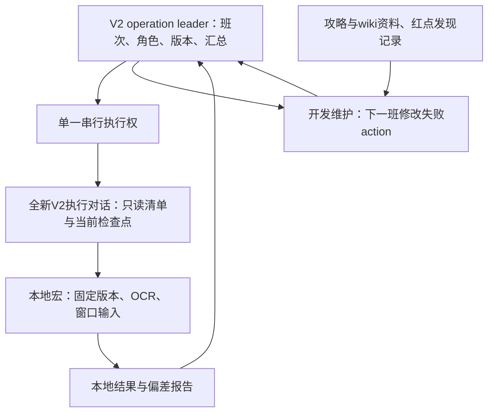

# V2三班运行与分工

## 当前阶段

当前是有限三班试运行，不是完整无人值守日常。每班参与账号串行各跑一遍，可信的同班已有执行记录可以直接计入。班间修订上一班失败项，稳定流程不重复做回归。角色、班次日期、窗口与单次报告由本地campaign维护，旧V1定时保持暂停。初始授权为二、三班各一次自动唤醒；用户随后明确授权第三班结束后未及时反馈时，从次日起继续每日三班试运行。具体日期和排程核验留本地campaign；后续反馈优先。持续唤醒不代表锁屏可靠性或生产化验收通过。

一班UTC00、二班UTC08、三班UTC16。当前温哥华分别是前一日17:00、当日01:00、09:00；“一天”以UTC游戏日归档，跨本地午夜不另开游戏日。当前试运行只在对应窗口执行，不等待单项冷却，不把下一班任务提前算完成。

任务按班、日、周、四周（月）、特定活动维护，见[任务清单](../skills/play-whiteout-survival-macros/references/visit-plan.md)。四周按服务器活动周期处理，不按自然月猜日期。未宏化日常仍是覆盖缺口。

## 整班完成与单次批次停止

Leader的开发维护工作与固定宏执行分开：每班逐号推进，新增/失败action在批次之间修订并定向验证；单次执行不让agent接管补做。某批因锁屏或未知出口停止时，先保存偏差；环境恢复并重新取得协调时段后，继续本班其余账号和未执行项，不将停止范围自动扩大为整班取消，也不让排障研究替代本班覆盖。

角色已有可信同班通过证据的任务直接计入，失败尝试与后续修订各自留档；不重复半价消费或稳定流程刷成绩。整班只有所有参与角色都得到本班处理结果，才可结案；存在尚未启动的角色时应标进行中或中断，并显示未执行分母，不能以“有偏差完成”掩盖。

## 运行分工

- Leader负责应做分母、角色差异、唯一执行权、班间版本切换和最终报告，不逐步发游戏点击prompt。
- 执行者从全新的V2上下文启动，只读本班manifest、宏技能与本地角色配置；一次调用固定批处理，最后记录偏差，不补做未宏化任务。
- 开发与资料整理可以并行做离线工作；游戏窗口始终只有一个执行者。开发改宏期间不可同时操作执行中的游戏。
- V1 leader仅改进离线报告追踪，不继承其旧补漏prompt，不启动V1日常。V1知识技能保持历史版本。

## 持续运行的启用条件

先完成当前三班试运行。连续两班的身份、执行权和交接锚点可靠，清单内失败均可归档，且没有未知页停轮、锁屏/权限阻断或重复消费问题，才为相应已验证清单启用新V2执行进程。持续运行只承诺该清单范围，报告必须同时展示完整日常覆盖缺口。未达到条件时保留准备方案，不派发声称已稳定的无人值守任务。

低等级辅助号按实际解锁维护独立适用清单；不为测试强行升级。主账号仍只运行已验证流程。

## 报告与验收

每班每号输出：应做任务、宏已覆盖任务、完成/冷却/未解锁/失败/未执行、证据路径、代码版本、准备/运行/报告耗时。模型内调用数与开发agent调用分开；缺精确token时填null，不从共享额度换算。结束执行与全部日常完成是两个字段。

V1离线追踪已按run_id选正式报告，checkpoint/device文件不重复计数；finish前验证实际报告文件、run_id和角色，并保存哈希。缺正式报告的运行进入report-followups，不能只靠对话里的“完成”结案。

## 下次讨论

准备资源价值与任务重要性排序，供下一次用户讨论：资源替代成本、稀缺性、过期/满仓风险、队列中断成本、活动窗口、任务依赖。先作为待讨论判断资料，不改变当前任务操作或减少应做日常，目标仍是完成全部日常。

## 宏与action版本

当前V2宏套件从 `0.1.0` 建立版本基线；各action在skill仓库的 `actions/` JSON中声明稳定的 `action_id` 与 `action_version`。版本从引入之日起记录，旧日志标为未版本化，不回填推测版本。

每个批次开始记录清单顺序、套件版本、各action版本与SHA-256；逐项报告和未执行项保留相同标识。恢复步骤继承所属action版本，报告附退出步骤名与实际内容哈希。这样同名任务的不同修订和错误未升版本的改动都可追踪。

OCR、时序或退出修复升patch；新增适用分支升minor；改变入口/出口或业务契约升major。每次发布动作或执行器变化同时更新套件版本，执行中的批次不得热改。版本不代替验收状态：失败要记录版本、分支、退出结果和证据；零奖励/冷却跳过与真实领取分开统计。

下一班优先炼晶、低等级VIP及失败退出，定向验证“已知业务偏差→预定义有限退出→主城核验→后续action”。未知页不能靠盲退绕过，必须补齐可识别页面的退出覆盖。之后补银行和其他日常，不重复回归稳定流程。

WOS动作的唯一维护来源现为 `skills/play-whiteout-survival-macros/`：`catalog.json` 注册动作身份，`macros/shift-{1,2,3}.json` 独立版本化组合与角色适用范围。发布包0.2.2与CrossMacro通用执行器0.1.4分别记录，不能混称一个suite版本。详见[发布包](../skills/play-whiteout-survival-macros/references/macro-package.md)。正式班次从固定manifest加载，新增action不得因旧本地六项清单而漏排；未纳入必须声明原因。银行尚未实现，保持覆盖缺口。

## WOS窗口协调

用户指定外部Orchestrator协调本项目其他任务，V2开发/班次任务优先；它可以与本线程协商时段，窗口闲置时及时让出，不长期独占。具体线程和预约留本地campaign及协调目录。

所有WOS输入（含切号）先取得协调时段，再检查唯一执行锁与租约；看到owner为空不能直接抢窗口。交接在有界动作结束后的已知锚点进行，不同时点击；执行结束关闭backend、释放租约；资源可用性改变时只通知Orchestrator可用时段及分配所必需的信息。具体角色/页面、操作计划、测试结果与偏差留在运行记录，不作常规转报。若其他任务来不及结束，先协商，不在它持有输入权时开第二个执行器。

每个P1操作区间之前预留5分钟空白缓冲，其他任务须提前完成并释放，不排满到起跑时刻。具体本地时间由campaign维护；此为用户最新5分钟规则，替代此前15分钟及10分钟边界。

与Orchestrator只沟通/协商资源使用时间；时段及可用性无变化时不发消息，不为同步计划、测试或研究细节触发对方执行。

班次到点后优先进入已授权的本班工作，不让其他对话进展或非必要研究延迟启动；消息可简短回复后继续。延迟到达的唤醒必须读取campaign并接续当前状态，不重复启动已执行账号。

第二班现场发现：独立MCP进程在锁屏后可能报无法关联ChatGPT线程，属于全局停止。短时锁屏往返通过不能证明长期独立运行可靠；启用持续调度前还需验证官方受信任线程调用路径，不能伪造信任元数据或关闭锁检查。

## 条件延续与排程核验

用户已授权：当前第三班结束后若未及时反馈，次日起继续每日三班，收到后续反馈时先采用新指示。每班仍是维护后固定宏逐号串行一次，失败记录不补做，不重跑稳定流程；权限/锁屏阻断仍停止输入。当前稳定生产worker的验收门槛继续有效，不阻止这项已明确授权的试运行唤醒。

定时配置不能只核对文件里的小时数字。必须同时核验应用调度器的下一次名义时间、实际派发时间、时区和近期运行记录。已发现裸BYHOUR规则按UTC解释导致本地时间错误，后续使用明确起始时刻并在创建/更新后核对实际下一次时间。循环唤醒可能有数分钟浮动，早到先离线准备，到计划时刻再输入；晚到按当前班继续，不无界补跑过期班次。

Orchestrator询问时只答复所需窗口：当前计划01:05、09:05、17:05，预计每班30分钟、以实际释放为准，前5分钟空白缓冲。无变更不发送额外消息，具体操作计划与结果留运行记录。
