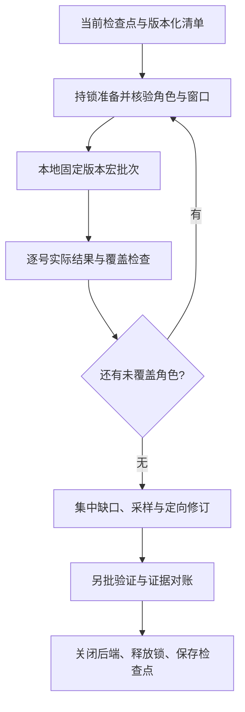

# WOS自动化2.0：CUA运行版

依赖OpenAI CUA的现行运行架构定义为2.0；独立原生Studio目标定义为3.0。这不改变包、action与执行器各自的组件版本。架构设计见[WOS-RUNTIME-ARCHITECTURE](WOS-RUNTIME-ARCHITECTURE.md)，V3迁移与验收见[WOS-V3-NATIVE-RUNTIME](WOS-V3-NATIVE-RUNTIME.md)。

现行工作为四个角色串行执行本地宏、逐号模型覆盖检查、现场开发恢复与版本迭代。生产状态以当前本地检查点为准，不从早期单次实验推断排程暂停、只支持七项或禁止补做。

Python批处理是当前入口；识别、颜色／图像条件、输入、等待和预定义退出由本地执行器处理。CUA仍提供生产截图和输入，不因宏内部没有模型调用就称为完全独立原生后端或零总token。CrossMacro编辑器不是运行必经步骤；具体命令和部署见[macro-package](../skills/play-whiteout-survival-macros/references/macro-package.md)。

授权只读[PROJECT-CONTEXT](PROJECT-CONTEXT.md)，执行只读[V2-OPERATIONS](V2-OPERATIONS.md)，任务契约见[WOS-V2-TASK-DESIGN](WOS-V2-TASK-DESIGN.md)。[早期文档](archive/wos-instructions-2026-11-03/docs/WOS-AUTOMATION-V2.md)与[架构PNG](archive/WOS-AUTOMATION-V2.png)仅供追溯，不提供当前限制。
