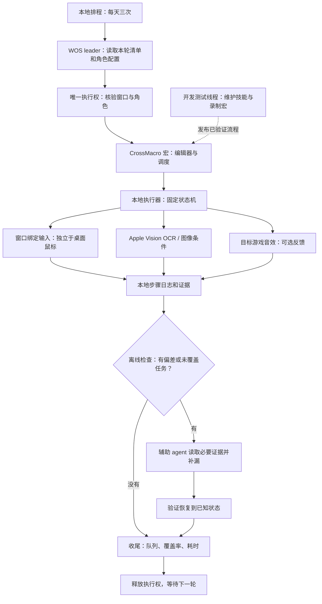

# WOS 自动化 V2

V1 是既有 `play-whiteout-survival` 纯 agent 方案，源码原样保留。V2 的目标是让固定流程在本机执行，agent 只负责计划、检查和未覆盖分支。

宏运行的每一步不需要模型。声音表示“可能收到输入或播放了某种反馈”，最终状态仍由视觉断言或后续检查确认。异常不盲重试；音频不可用回退OCR。开发线程和leader不能同时操作游戏。

| 层 | 职责 | 当前状态 |
|---|---|---|
| 游戏知识 | 任务入口、刷新、完成判据、资源策略 | V1保留，V2增加三轮任务表 |
| 账号/时间计划 | 私有目标、每日三轮分配、执行权 | 本地记录；长期排程保持暂停 |
| CrossMacro | Shell步骤、编辑器、单次/调度入口 | 已验证探索宏；新增宏继续回放 |
| 本地后端 | 截图、Vision OCR、窗口绑定点击、目标进程音频 | 实验原型；独立输入仍依赖用户已安装CUA运行时 |
| 检查与补漏 | 先离线审计，再按需agent | 已有检查器；整轮补漏继续实测 |

当前不是完全独立发布的软件：CUA后端不是CrossMacro内置的开源macOS输入实现。锁屏、退出宿主后的无人值守还未成立。不能把一次前台正常运行等同于24小时托管。

三轮任务详表见 `skills/play-whiteout-survival-macros/references/visit-plan.md`。身份、截图、录音和机器路径仅存 `local-data/`，不进入公开仓库。

当前落地的三次计划会明确列出尚未宏化项目，交给agent检查，不能把“宏目录里没有”当成“本轮不需要”。本地计划生成器只生成清单；长期任务仍暂停，没有因为开发自动启用新日程。

长对话压缩可能丢失当前阶段。新运行记录应保留原始用户授权来源、唯一执行者、宏版本、固定任务清单、当前阶段、截止和结果指针，恢复时先读该记录；不能靠重新累加长prompt恢复状态。
