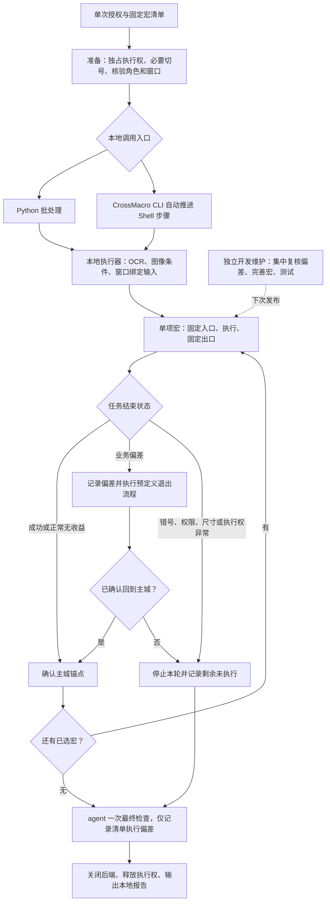

# WOS 自动化 V2

当前目标：**已有宏批处理 → 一次最终检查 → 只记录执行偏差 → 独立维护任务修订宏**。不检查清单外日常、不补做、不现场扩展宏。V1 纯 agent 技能保持原样。

任务状态与实施安排见 [V2 任务设计](WOS-V2-TASK-DESIGN.md)。下图是目标架构；实现状态见后表。当前只做单次实验，尚未启用每天三次或多账号自动运行。

## 当前实现与目标的区别

| 层 | 当前实现 | 尚未完成 |
|---|---|---|
| 调用入口 | Python 批处理；CrossMacro CLI/Shell 回放也已测试 | 统一任务结果和任务级调度接口 |
| 宏任务 | 七项基础流程及招募、帮助、捐献和训练候选；固定主城交接 | 情报、竞技场、宠物、采集等覆盖仍缺；候选分支逐项验证 |
| 本地识别 | Apple Vision OCR、限定区域文字定位、颜色与倒计时断言 | 扩充真实可领、无奖励和异常分支的回放样本 |
| 输入 | 配置的 CUA 运行时提供窗口绑定输入 | 不依赖宿主的开源原生输入实现尚未建立 |
| 音效 | 目标进程采集与可选反馈原型 | 本轮默认依靠视觉验证，未证明完整日常减少截图 |
| 遇错处理 | `task_batch.py` 实现预定义有限退出、回主城验证、继续下项；已有现场故障隔离证据 | 未知页、身份/权限/窗口异常仍停整轮，不承诺全部页面可恢复 |
| agent | 启动、必要准备、一次最终检查和偏差记录 | 不承担失败任务的临场补做 |
| 排程与多角色 | 配置、只读规划器；旧定时暂停 | 修好单任务组合后再验收多角色串行执行 |

两种入口复用相同本地执行器，但不是每次都经过 CrossMacro。本次跨角色试验直接使用 Python 批处理；不能将该批处理的停止策略归因于 CrossMacro。CrossMacro 编辑器用于开发编辑，运行时不需要 agent 截图或点击编辑器。

## 实验证据的范围

六类61步组合宏曾在同一已校准角色的冷却/空奖励状态回放通过。它只证明所遇分支，不证明六个完整任务已通用化，也不能用步骤数代表日常覆盖率。

后续换角色单次实验：邮件通过且系统邮件出现奖励弹层；VIP页出现可领按钮，而宏只支持冷却检查，故在倒计时断言处停止。后续四宏未执行。宏内部0模型调用，本地35次截图、36次OCR，批处理49.55秒；这不是完整六宏或完整日常耗时。身份、截图和原始记录仅留本地。

## 执行条件

窗口输入、OCR和截图每步由本地程序调用，不请求模型判断。音效只能提示动作响应，不能单独证明身份或奖励结果。开发与执行必须串行，角色不符、输入被拒或窗口尺寸变化停止。

原生CUA任务、独立宏进程的锁屏能力须分别验收。已有锁屏解锁失败记录，不能将未锁屏成功等同于无人值守可用。启动前检查组件版本、运行环境并实测目标窗口可读；这些检查不能保证后续闲置锁屏不会复发。

账号、时区、排程、资源授权和运行证据均由本地配置提供，不写入公开技能。计划生成器只规划已宏化项目，不操作游戏，不启用排程。

[早期架构 PNG](archive/WOS-AUTOMATION-V2.png) 仅作历史记录，其中agent补漏目标已经撤销；现行设计以上图和任务设计为准。

## 后续迭代进度

本地批处理已在不同顺序下连续跑完七项基础宏，最快现场批次约140秒；该批次包含冷却和空奖励，不能作为完整日常耗时。学院领奖后动画造成断言失败时，程序按两条已声明退出步骤恢复主城，随后联盟宏继续成功。新增联盟“全部帮助”已有真实请求回放通过；免费招募、普通资源捐献、训练流程按候选单独验证。维护清单统一见 [visit-plan](../skills/play-whiteout-survival-macros/references/visit-plan.md)。后续优先补覆盖，只针对新增/失败项测试；长期定时仍暂停。
