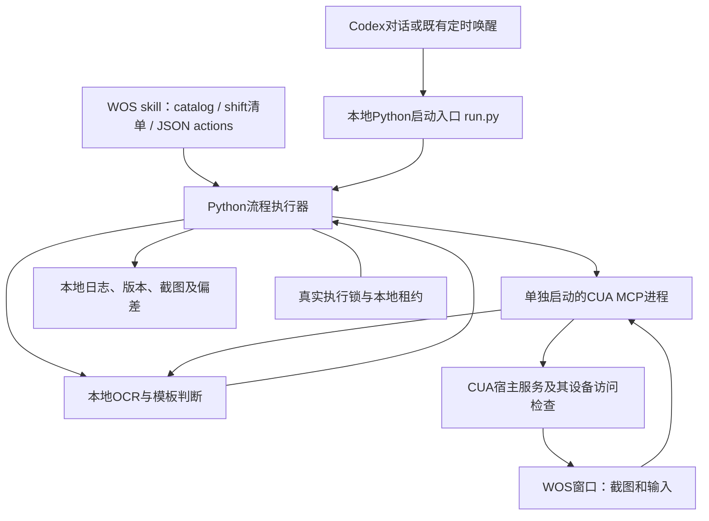
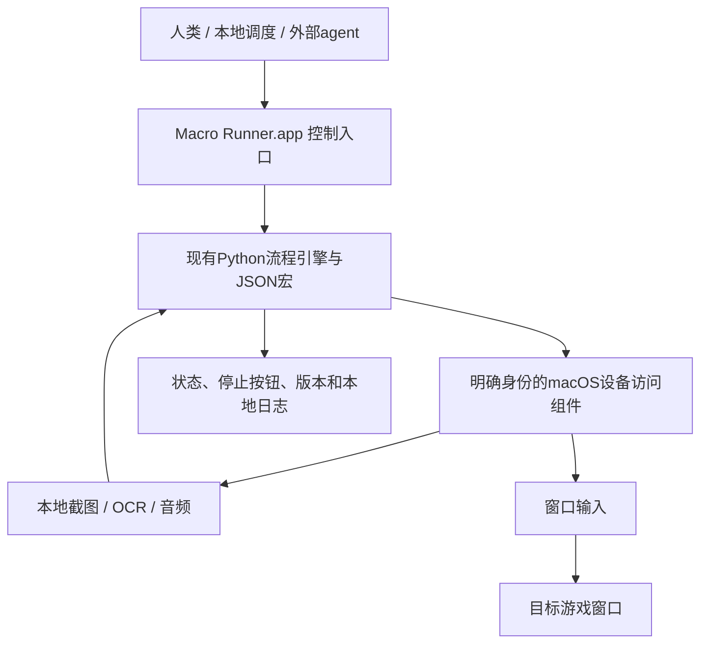

# 本地宏运行架构与 App 身份

讨论日期：2026-10-18，America/Vancouver。现行包0.9.4，Python执行器0.2.7。本文区分已实现现状与下一步设计，不代表已构建App、授予权限或通过锁屏验收。游戏任务范围仍由[visit-plan](../skills/play-whiteout-survival-macros/references/visit-plan.md)维护。

## 当前实际调用链

- `local-data/crossmacro/v2/run.py`是私有路径绑定入口，调用skill的`scripts/run_visit.py`。
- `run_visit.py`载入并冻结动作，导入CrossMacro fork中`tools/macos-window/window_macro.py`及`task_batch.py`，直接运行Python流程。
- `CuaMcp`自行启动插件配置中的MCP子进程，截图、输入仍经CUA宿主服务。它没有获得已验证的当前对话可信关联；不伪造关联或授权元数据。
- 本地OCR工具与模板匹配处理图像，宏内部不逐步调用模型。切号准备、开发采样与最终偏差审计属于外部agent工作，尚不等于所有准备步骤均已无人值守。
- CrossMacro桌面编辑器、键鼠录制、原有回放引擎及桌面调度器未进入这几轮实际调用链。仓库路径不等于操作系统执行身份；把Python代码放进CrossMacro仓库不会使其成为CrossMacro App的权限主体。
- 现行脚本没有为本项目提供一个统一、稳定的独立App身份。Python、MCP进程、宿主服务是不同组件，不能把它们的设备访问权限视为自动共享。

## 当前锁屏阻断的确切边界

本次在启动独立CUA后端时返回：`The Mac is locked and this Computer Use request cannot be associated with a ChatGPT thread.` 同时要求用户手动解锁。启动约0.5秒，0截图、0游戏输入。它与之前第二班的错误一致。

这是当前CUA路径的宿主关联检查失败，不是已证明的辅助功能/屏幕录制授权缺失，也不是用户撤回游戏授权。此前部分对话调用在锁屏下通过，不能外推独立进程具有相同支持。手动解锁能否恢复、自然熄屏、锁屏、睡眠是不同状态，分别验收。

## 讨论方向：明确的运行体

用户提出给脚本执行体一个确切身份（例如App），让macOS授权对象清楚；这是本轮认可的设计方向。建议工作名为`Macro Runner.app`，正式产品名、Bundle ID、签名与发布方式尚未确定。

App先提供生命周期、权限状态、开始/停止、运行状态与日志入口；可以保留Python和已有JSON，无须为获得App身份重写全部业务或先做复杂编辑器。

实际截图、录音、控制窗口的组件须纳入明确的进程/签名设计。仅用一个App启动外部Python或第三方helper，不足以保证所有子进程的权限都归属于这个App；需要实测系统显示的授权主体及更新后的行为。

## 三个独立问题

|问题|App身份的作用|仍需验证|
|---|---|---|
|macOS权限对象|明确名字、Bundle ID、代码签名身份与安装位置；便于在系统设置识别截图/音频/控制权限|实际请求进程、helper权限归属、重启/更新后是否保持|
|CUA宿主信任|App外壳本身不会建立ChatGPT线程关联|如保留CUA，需其受支持的集成方式；不得伪造身份或绕过明确拒绝|
|后台、独立光标与锁屏|身份不直接提供这些能力|输入API、截图API和会话状态分别决定；屏幕熄灭、锁屏、睡眠逐项验收|

## 下一步技术核实

1. 固化现行调用链，区分已实现和候选；不再把仓库内新增执行器简称为完整CrossMacro产品。
2. 确定设备访问后端：CUA受支持集成，或自有原生后端。后者是新的产品实现路径，必须独立评估公开API、独立窗口输入和锁屏能力，不能用来重试或绕过当前被拒的调用。
3. 设计最小App及其设备访问组件的稳定身份、权限请求与签名更新策略；正式授权由用户通过macOS完成。
4. 先验收无业务影响的读窗口/输入测试，再测试熄屏与锁屏。明确授权成功不等于锁屏执行成功；不降低系统安全保护。
5. 复用已有流程引擎、宏、日志和可组合任务契约。编辑器和调度UI可后接，不是首个阻断点。

尚未决定：是否继续以CrossMacro fork为产品外壳、最终App名称和Bundle ID、原生独立光标API可行性、锁屏运行支持路线。

## 参考

- [Apple：辅助功能应用访问授权](https://support.apple.com/en-mn/guide/mac-help/mh43185/mac)：控制权限需由用户在系统设置明确授予。
- [Apple：屏幕与系统音频录制权限](https://support.apple.com/guide/mac-help/control-access-to-screen-and-system-audio-recording-mchld6aa7d23/mac)：按应用管理录制访问。
- [Apple TN3127：代码签名与身份要求](https://developer.apple.com/documentation/technotes/tn3127-inside-code-signing-requirements)：稳定代码身份需要考虑签名要求，不只看App显示名。

相关任务契约见[任务设计](WOS-V2-TASK-DESIGN.md)。资源/任务重要性另见[待讨论记录](RESOURCE-TASK-PRIORITIES.md)，不会因此减少日常覆盖。

## 后续排查：受支持的对话调用入口

官方[App Server 文档](https://learn.chatgpt.com/docs/app-server)明确提供`mcpServer/tool/call`，参数指定真实`threadId`及该线程配置的server/tool；`mcpServerStatus/list`也可复用该线程连接。这是值得接入验证的正式路径，不是向自启CUA填入猜测的信任元数据。

本机只读探测发现CLI默认App Server控制socket不存在，尚未实际发出该方法调用；不能把文档存在写成已成功接入。当前对话自带CUA能够重新取得游戏窗口，随后尝试继续本地宏；这只证明一次访问恢复，独立锁屏与持续对话关联仍未验收。完整架构债记于[issue #1](https://github.com/carolplay/codex-game-skills/issues/1)，全面重构暂缓。
