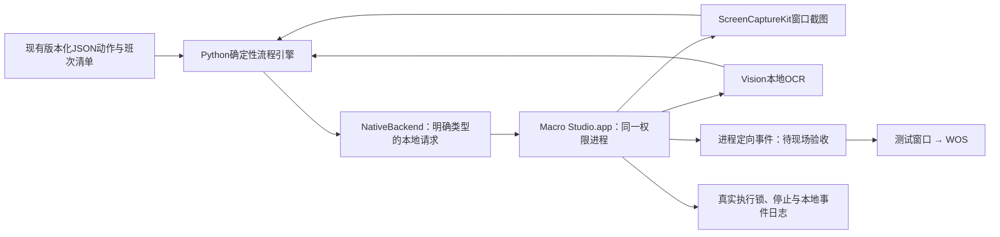
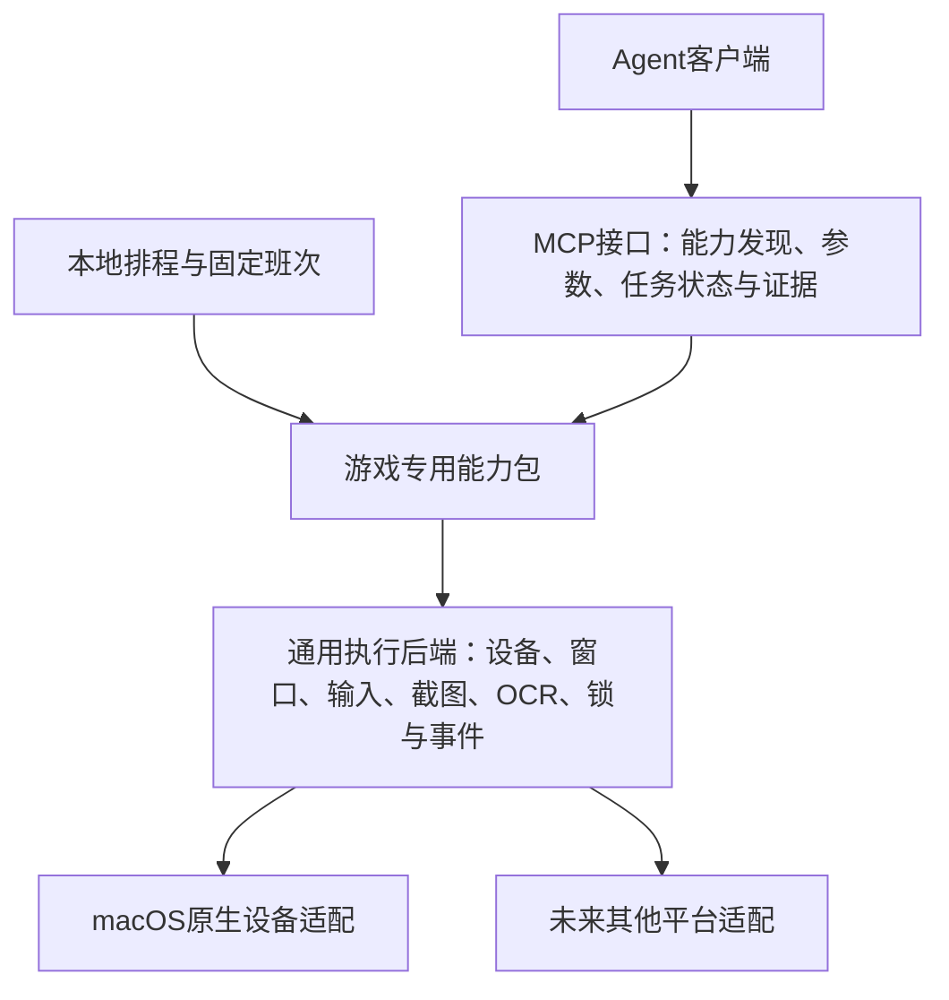
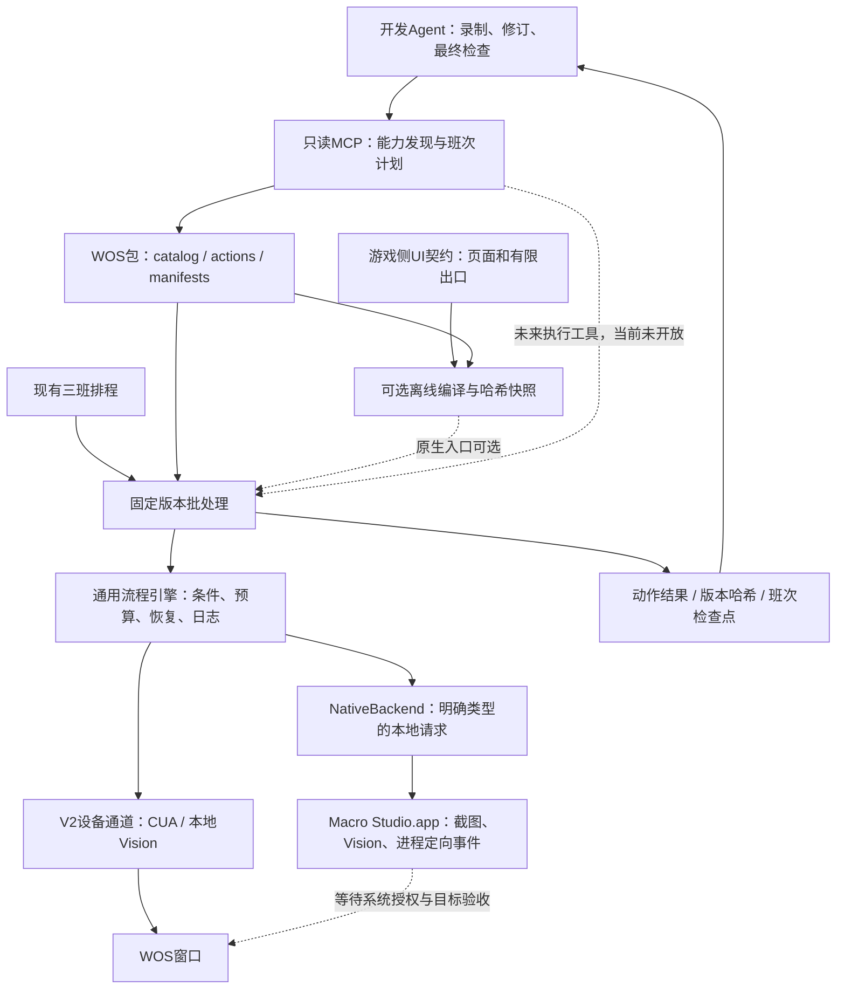

# V3：原生设备执行器

## 当前候选与签名状态（2026-10-26）

0.1.7候选已编译，未安装或迁移生产。它包含可配置的CG事件位置/窗口坐标戳/触摸相位、测试窗内输入开关、用户显式开启的两小时开发会话，以及仅在空闲时可用的正常退出接口。普通批次结束仍释放真实flock；开发会话到期、停止、会话离开、休眠、权限撤销或客户端超时均撤销许可，启动和重启默认关闭。40项原生Python测试与Swift事件/授权状态测试通过，不等于现场原生游戏输入验收。

用户已授权并通过macOS证书助理在登录钥匙串创建专用代码签名证书及新私钥，未复用已有密钥，未导出私钥。首次候选签名完成，DR绑定专用证书而非某一版cdhash；严格签名验证仍返回CSSMERR_TP_NOT_TRUSTED，因此签名候选没有安装。当前未更改用户或系统信任设置。若采用仅当前用户、代码签名用途的专用证书信任，需要用户另行明确批准；也可改用Apple开发证书。不能通过降低验证要求或修改TCC数据库取得通过结果。

构建默认进入候选目录，并拒绝用临时签名直接覆盖已有固定路径App。后续须实际验证“构建A首次授权→同一签名身份构建B→DR一致、实际隐私权限保持”，再称授权连续性通过。0.1.5已记录测试窗口收到错误坐标的真实失败；0.1.6修订坐标戳后并入0.1.7候选，其现场测试尚待有效签名与授权。V2既有三班独立继续，原生候选等待不得变成全部游戏的永久暂停。

V3最小可用验收仍包括：签名及权限连续性、测试窗口真实输入、WOS身份往返和至少一个完整action、独立光标/后台范围、唯一执行锁与停止、游戏包版本和证据报告。生产三班和MCP改变状态的工具仅在对应目标验收后开放；只读发现接口与宏内部无模型不代表上述项目已完成。

## 当前验收摘要（2026-10-25）

固定原生App0.1.4未重编。录屏、辅助功能与共享Documents锁实际可用；本轮测试窗计数由2准确增至3，原生截图、Vision、一次点击及正常释放真实flock通过。事件日志中的测试窗目标未激活、指针前后相同，这是一个受控样本，不推广为所有目标均支持独立光标。

WOS原生会话、788×1079截图及本地OCR可用，但联盟宝藏正常关闭在显式local/screen坐标与phase参数对照中均未改变页面，尚未通过身份往返或一个完整业务action。用户报告手动前置后，NSRunningApplication激活日志仍为false，前后台结论不足；不能用该日志否定用户操作。当前对话V2同一关闭也报noWindowsAvailable。正常应用菜单退出未确认进程结束，等待手动重建窗口后重新核验；没有自动迁移生产，也未以原生通道绕过系统拒绝。证据在私有V3检查点，不包含公开账号或截图。

以下带旧日期的等待、版本和实现描述为历史过程；当前验收以上述摘要、catalog及本地IMPLEMENTATION-CURRENT.json为准。测试窗通过不等于WOS通过，生产三班仍保持V2。

2026-10-23开始实施。目标是让已发布宏在本地执行时脱离CUA和对话身份检查。第一阶段只验收已登录、已解锁的Mac；原生App不提供解锁机制。当前平台拒绝时停止，环境恢复且原生权限完成验收后才正常执行，不用迁移绕过正在生效的拒绝。

## 2026-10-23确认：通用后端＋游戏能力包＋MCP接口

用户确认V3按三层设计，先用WOS跑通，再依次拓展大航海时代Online、魔兽世界。本节是已确认的目标架构，不代表MCP服务或另外两款游戏能力已经实现。

- **通用执行后端**不包含WOS按钮、角色或日常策略。统一设备状态、窗口尺寸、输入、截图、OCR/图像条件、实际互斥、取消、超时与事件；背景输入和光标隔离逐平台验收。
- **游戏专用能力包**维护页面与跳转、语义动作、前置条件、参数、业务依赖、完成证据、退出恢复、版本及已验证分支。现有WOS JSON宏与manifest是第一批资产；任务清单仍由visit-plan维护。
- **MCP接口**发布经过验证的游戏业务能力，不将任意点击包装成已成功的游戏动作。查询与改变状态的工具明确区分；能力发现包含版本、参数与验收范围。返回completed/cooldown/unavailable/blocked/failed等业务结果和证据，不能把input_sent当completed。

固定班次可以直接调用能力包，MCP是Agent可选入口，不让每一步经模型或MCP往返。航行、寻路等长任务采用start/status/cancel及本地持续控制器，Agent不逐帧轮询。MCP、CLI、UI、排程共享同一Worker与实际执行锁，不新增第二套会抢窗口的执行链。

能力包应支持本地条件循环、找到即停的列表搜索、一次确定后保持的页面布局分支，以及基于真实冷却的等待与续作；不要求把每次观察展开为重复JSON步骤。现有JSON的锚点、模板和版本证据可以复用，控制流程可逐步迁为有明确输入输出的本地能力。仓库逐档领取、灯塔新旧布局和采集达标后回城结算是WOS首批验收用例；这是目标设计，当前V2仍按固定快照执行。

**推进顺序**：通用原生设备后端测试窗验收 → WOS身份往返与一个已有能力完整执行 → 少量WOS能力MCP封装及与直接执行结果对照 → WOS全班复用与稳定性验收 → 大航海港内生产/交易 → WoW非战斗状态与菜单能力。三维导航与战斗另设控制模块，不视为UI录制自然可得。

**资料原则**：攻略用于目标与前置条件，录像/实操用于路径素材，已有脚本和插件用于理解状态与异常；按版本和依赖评估可复用范围。WoW插件数据桥接与受保护动作、区服版本，以及大航海Windows客户端的平台适配仍待研究。暂不安装、运行或创建这两款游戏项目。

**不变边界**：V3首版不承诺锁屏运行；不通过MCP改变系统权限或平台审批。原生权限由用户授予，生产调度在验收后才切换。今天二三班补欠与V3开发分别留证据，宏回放、模型补做、人工完成不能相互改写。

## 本轮实现范围

源码在独立CrossMacro仓库的`tools/macos-native-studio/`。本地构建固定放在该仓库`local-apps/Macro Studio.app`，Bundle ID为`io.crossmacro.macro-studio`，原生设备组件0.1.0；动作引擎新增类型化输入分发，当前版本0.4.9，旧CUA实现保留兼容，未修改其审批或信任处理。

App自行执行窗口枚举、截图、OCR和实验性的进程定向点击/方向键；不启动CUA、不接收任意代码、不监听网络端口。控制端口是仅当前本地用户可访问的Unix socket。App内手动启用输入后，`begin`取得与V2相同的实际`visit.lock`；结束、停止、会话离开或客户端120秒空闲会撤销输入并释放锁。JSON租约不是权限凭据。

`native_visit.py`复用现有catalog、manifest、action、图像模板、身份条件、资源策略、有界退出和报告。先离线校验；显式执行才连接App。原生端不做不透明JavaScript转发；旧宏的点击与按键由两个明确接口分发。执行记录同时保留包/action/引擎/原生后端版本，旧报告保持原样。

## 当前验收与未完成项

最新开发状态：原生0.1.2已通过真实测试窗计数与一个参数对照；0.1.3的可选本地兼容投递也以窗口位置记录通过测试窗，采样中指针未移动、目标未激活。WOS仅观察到一次欢迎页转入礼包，后续关闭/档案输入尚不稳定，**未通过完整原生能力验收**；官方CUA的一次礼包关闭参考输入另记，不计原生通过。0.1.4候选刷新松开事件实际时间戳并提供有界按压时长，已编译；本轮两项权限已重新添加并识别为允许。随后启动测试在打开Documents内共享锁时阻塞，线程采样定位为`__open`，系统TCC日志显示文稿文件夹的旧签名要求不匹配并正在提示。尚未发送0.1.4测试点击；需用户手动处理这项单独的文件访问提示，不能把它算成鼠标失败。较早小节的等待/版本状态为历史阶段，以本段及本地IMPLEMENTATION-CURRENT为准。

0.1.3开始的可选兼容模块使用系统未公开的`SLEventPostToPid`和`CGEventSetWindowLocation`，因此初版“仅公开API”的范围不再覆盖这一实验分支。它不调用OpenAI CUA服务，不构造认证消息、不改写事件源身份、不注入激活记录、不使用全局HID回退，也不改变系统安全保护。API缺失即停止对应请求。该分支尚不能替代生产V2或承诺锁屏执行；参考与许可说明随执行器源码保存。

后续现场复测：移除旧TCC条目、重新添加固定0.1.1 App后，两项权限已由实际doctor确认生效；原生截图/OCR通过，点击点位落在按钮内，但测试计数仍未增加。当前问题已定位为输入效果未通过，不再等待用户授权；0.1.1保持原样，不再次重编或要求重复授权。原生会话已正常结束，没有WOS原生输入。前台/后台对照尚未建立，不能把当前失败武断归因为后台首击。

最新现场结论（2026-10-24）：用户授予0.1.0两项权限后，实际doctor确认均已生效，原生截图与OCR成功，但测试按钮计数未增加，故原生点击验收失败，未向WOS发送原生输入。0.1.1候选修订为带明确窗口编号的AppKit事件，并设置公开的CG窗口路由字段；已编译通过，尚待现场验证，不能宣称修复成功。客户端0.1.4保存失败前后截图、OCR、点击点及实际窗口标题。

安装0.1.1到同一路径后，两项TCC权限实际丢失：本机临时签名重编的权限延续测试失败，固定Bundle ID不足以解决。原0.1.0 bundle已本地备份，当前0.1.1等待用户重新授权；后续稳定签名是发布工作项。生产排程仍V2，共享实际锁已释放。以下授权等待与实现小节保留先前阶段背景，以前面的“最新开发状态”及本地检查点为准。

共享引擎当前0.4.9，136项代码测试通过；原生runner0.1.3、客户端0.1.3，原生接口/契约/lease/存储36项测试通过。实际WOS宏版本以catalog和每次summary为准，不能用源版本替代运行版本。

Macro Studio.app仍为0.1.0，固定路径及临时签名未重建。2026-10-24用户重新授权V3开发与三班测试，覆盖此前暂缓现场测试的安排；App已打开，实际屏幕录制/辅助功能仍未授予，已提供路径等待用户手动授权。原生测试窗、WOS截图/身份往返/一个完整能力、后台输入、独立光标、重启更新后权限、熄屏/休眠均待分别验收。当前未发送原生游戏输入，生产继续V2，无自动降级或新调度器，V1保持暂停。

第一轮必须先用App自带测试窗口核对点击计数精确增加一次；事件发送不等于成功。随后在独立时段测试WOS，再逐步开放MCP执行能力和唯一生产入口。当前App需要手动启用输入会话，不能宣称无人值守原生三班已经完成。首版不提供解锁机制，不通过迁移绕过平台拒绝。

首版尚非完整Studio产品。声音、原生录制、拖拽/滚轮、可视动作编辑、调试时间线、独立运行库、持续Worker和生产迁移仍需开发。临时签名不保证重编后TCC保持；固定Bundle ID与锁屏访问是不同问题。

## 离线MCP能力发现原型0.1.0

新增`skills/play-whiteout-survival-macros/scripts/capability_mcp.py`，提供本地stdio的`wos_capabilities`和`wos_shift_plan`两个只读工具。前者列出动作版本、哈希与声明的验证范围，后者读取一至三班的公开profile，校验catalog、action与manifest一致性，返回固定顺序、排除项及依赖。它复用现有包校验器，不复制另一份任务清单；不读取本地账号绑定、截图或余额。

接口只提供能力查询与离线计划，不导入设备后端、连接原生App、取得执行锁或操作WOS。所有返回明确标识原生WOS验收pending、无执行工具。即使V2某动作已通过，也不转化为V3验收。当前是WOS能力包的发现适配器；通用设备后端仍位于CrossMacro，尚未接入生产Worker。

启动方式：用本机Python运行上述脚本；MCP客户端command设为Python，args设为脚本绝对路径。包目录由启动者的`--root`配置固定，工具参数不能传文件路径、账号或执行选项。未添加到用户MCP配置，也未启用新排程。协议固定支持2025-03-26的初始化、tools/list、tools/call及换行JSON stdio；这是最小原型，不宣称所有MCP客户端互操作已验收。[MCP工具规范](https://modelcontextprotocol.io/specification/2025-03-26/server/tools)、[生命周期](https://modelcontextprotocol.io/specification/2025-03-26/basic/lifecycle)、[stdio传输](https://modelcontextprotocol.io/specification/2025-03-26/basic/transports)。

五项离线测试覆盖所有公开班次/profile、被篡改action拒绝、参数路径/执行注入拒绝、初始化与只读工具集合，以及真实子进程stdio往返；仅证明离线发现接口，不代替原生权限、WOS输入、背景/光标隔离或锁屏测试。后续执行工具必须接唯一Worker和真实锁，并在原生目标验收后另行开放。

## 2026-10-24下午：三班验证与原生授权边界

用户重新授权继续V3与三班测试，覆盖此前暂缓原生实测的安排。Macro Studio.app已通过当前对话正常打开，实际诊断仍为屏幕录制/辅助功能未授予；已提供固定App路径等待用户手动授权。App仍0.1.0，未重编以免授权主体漂移，也未把原生拒绝改成CUA自动降级。当前三班生产继续使用既有V2设备通道，单独记录共享引擎的现场结果；原生测试窗与WOS验收仍待进行。

共享执行器0.4.8将本地action时间预算与系统/传输失败分开：业务预算耗尽记偏差，重新观察并只走声明的页面出口；整个退出阶段默认60秒、共享绝对截止时间，失败后不重新分配退出预算。确认主城才继续下一任务，锁屏/权限/身份/尺寸/传输超时仍停。131项引擎测试与原生客户端16项测试通过；这不是现场原生测试通过。

新增游戏侧`capabilities/ui-contracts.json`版本0.1.0，抽取主城、地心根页、专家游历根页、商店周卡根页与其有限出口。CrossMacro提供通用`capability_contracts.py`解析页/出口引用，禁止循环、未知引用或覆盖字段；编译快照同时记录原始action及registry哈希。原生入口通过显式`--contract-registry`离线编译，不修改现有V2 action或生产manifest。三班main/mature-test各41项、under30-test31项完整离线载入已通过；新增五项引用解析测试使原生端测试总数为21。保存帧/离线结构、共享引擎V2现场、原生App现场三类证据保持分开。

## 当前实现与生产接线

生产仍走V2设备通道。共享引擎修订可以先通过V2验证业务执行和退出，但不会因此证明原生截图、后台输入或独立光标有效。原生App固定0.1.0和既有签名未重建；诊断客户端已迭代到0.1.3，并能识别其他执行器占用的真实共享锁，而非只看App自身run_id。原生客户端/契约/lease/存储测试36项。

0.4.9共享引擎把同帧全图优先扩展到点击坐标的text_target：唯一、区域内、达到原置信度才直接采用，否则保持原裁区回退。默认行为不变，开关要求同时保留crop_ocr。136项引擎测试通过；本轮盾兵保存帧全图正确而裁区漏读，候选定位已离线通过，下一角色现场范围另记。当前运行中的旧引擎快照不因源码修订而回写版本。原生权限、测试窗、WOS身份往返和一个完整能力的真实验收仍不可被离线测试或V2结果替代。

原生runner0.1.1在App已取得真实flock后才登记本地lease，活动刷新元数据，清理时核验实际锁释放；run_id仅属于本地原生会话，与ChatGPT身份无关。真实临时flock与runner集成测试使原生客户端/契约/lease测试增至29项。已在V2持锁时实测doctor识别shared_lock_busy；这不是原生输入通过。UI契约0.1.1加入实操发现的游历完成弹层与总结页出口，原生仍只离线编译。

原生runner0.1.3在启动前检查证据存储空间（默认至少1GiB），元数据使用临时文件写入、fsync后原子替换。磁盘不足时不启动设备输入，失败写入不截断旧检查点。实际三班回放遇到磁盘满，原始summary保留；本地班次已从summary和既有证据重建，并分别记录环境失败与续作，不重复已完成任务。

原生每次观察前还检查64MiB证据空间余量；不足时在新截图请求前停止，剩余任务记未执行，不另走恢复输入。这是尽力预检，不是磁盘配额，也不能保证其他进程不会同时写满磁盘。

## 权限诊断补充：文稿文件夹

若唯一执行锁位于Documents，App打开锁文件也可能触发macOS文稿文件夹访问提示；这与录屏和辅助功能是独立授权。临时签名更新后，曾经允许的文稿访问同样可能失效。本轮用户授权自动更新的范围仅为既有两项权限，新增文稿提示需用户手动处理；不更换锁路径或移除互斥来规避它。当前同步文件打开位于主线程，等待系统提示会使窗口和本地接口同时超时，这是应修订的可响应性问题；未来版本需有界异步准备及迟到请求失效处理，避免客户端超时后才建立会话。

## 2026-10-26当前验收状态

当前已安装App为0.1.5；0.1.7仅在候选目录构建，未部署。旧原生模式曾通过自带窗口，WOS仍未验收；0.1.5直接CG事件在测试窗暴露坐标偏移，候选修订将屏幕坐标与窗口局部标记分开，后续必须先重新通过计数测试再试WOS。事件“已发送”不代表游戏接受。候选提供用户在App主动开启的两小时开发许可，正常批次结束释放锁并保留许可，停止、到期、休眠、权限撤销及客户端超时均撤销；无法由接口自行授权。

为减少重编后的重复授权，用户已批准创建专用本机签名证书与私钥，保存在登录钥匙串。首次签名完成，但严格验证仍报告自签证书不受信任；没有改动信任设置，没有安装该候选。是否仅建立当前用户、代码签名用途的信任仍待用户决定。后续须比较两次构建的实际签名要求及macOS权限保留，不能仅凭相同应用名称判断授权会延续。诊断工具已将签名未验证与运行/磁盘版本不一致列为阻断条件，40项客户端测试通过；生产三班仍走V2。

候选0.1.8进一步将Documents共享锁的打开移出主线程，八秒未完成即返回超时，迟到的文件描述符立即释放，不建立迟到会话；停止会使正在准备的请求失效，取得锁后再核验会话与系统权限。临时锁测试覆盖争用、打开失败、超时及迟到释放，候选构建通过；实际系统提示与原生目标回放仍未验收。已取消过期0.1.7签名等待，避免重复钥匙串提示，已安装0.1.5保持原样。

## 2026-10-28：锁屏链路与熄屏分类

官方[Locked use说明](https://learn.chatgpt.com/docs/computer-use)将临时解锁限定为当前可信Computer Use回合，不为普通本地进程提供远程解锁。V2的Python后端独立启动MCP进程；本次长批次中真实出现“Mac已锁定且请求无法关联对话”，因此开头一次对话内准备不能被视为整轮授权续期。尚未找到公开、受支持的把该解锁能力授予普通宏进程的接口；不注入线程身份或令牌。

原生候选0.1.9修复另一类混淆：显示器熄灭不再直接标记用户会话失效，显示器唤醒也不能覆盖会话已退出/系统仍休眠的事实。状态机离线测试和候选构建通过，实际锁屏与TCC检查仍保留，lock_support仍为false；尚未部署或做WOS新版本验收。

签名诊断也必须区分执行环境：同一份专用证书签名的0.1.6候选，在受限shell报告CSSMERR_TP_NOT_TRUSTED，在正常系统环境通过严格验签。此前据受限环境推断必须额外建立证书信任的结论不足；本轮没有改动系统/用户信任。0.1.9使用既有专用证书签署，私钥操作仍需系统允许；完成签名后再验证同一签名要求跨构建和TCC保留，不以构建成功代替权限或输入验收。
