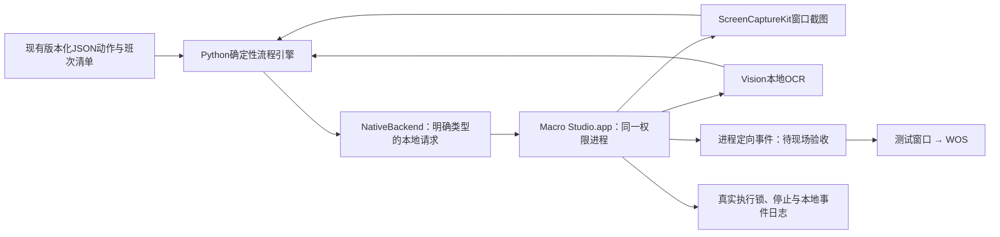
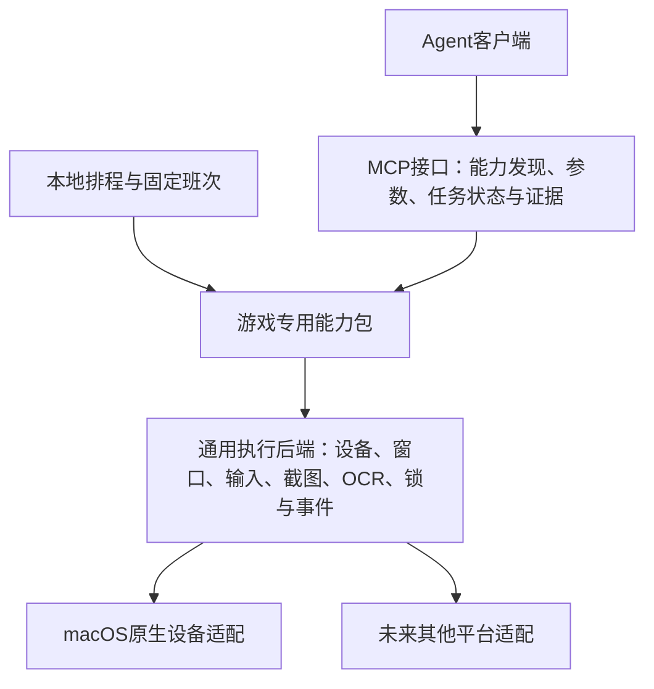

# V3：原生设备执行器

2026-10-23开始实施。目标是让已发布宏在本地执行时脱离CUA和对话身份检查。第一阶段只验收已登录、已解锁的Mac；原生App不提供解锁机制，不重试此前被平台拒绝的任务。

## 2026-10-23确认：通用后端＋游戏能力包＋MCP接口

用户确认V3按三层设计，先用WOS跑通，再依次拓展大航海时代Online、魔兽世界。本节是已确认的目标架构，不代表MCP服务或另外两款游戏能力已经实现。

- **通用执行后端**不包含WOS按钮、角色或日常策略。统一设备状态、窗口尺寸、输入、截图、OCR/图像条件、实际互斥、取消、超时与事件；背景输入和光标隔离逐平台验收。
- **游戏专用能力包**维护页面与跳转、语义动作、前置条件、参数、业务依赖、完成证据、退出恢复、版本及已验证分支。现有WOS JSON宏与manifest是第一批资产；任务清单仍由visit-plan维护。
- **MCP接口**发布经过验证的游戏业务能力，不将任意点击包装成已成功的游戏动作。查询与改变状态的工具明确区分；能力发现包含版本、参数与验收范围。返回completed/cooldown/unavailable/blocked/failed等业务结果和证据，不能把input_sent当completed。

固定班次可以直接调用能力包，MCP是Agent可选入口，不让每一步经模型或MCP往返。航行、寻路等长任务采用start/status/cancel及本地持续控制器，Agent不逐帧轮询。MCP、CLI、UI、排程共享同一Worker与实际执行锁，不新增第二套会抢窗口的执行链。

**推进顺序**：通用原生设备后端测试窗验收 → WOS身份往返与一个已有能力完整执行 → 少量WOS能力MCP封装及与直接执行结果对照 → WOS全班复用与稳定性验收 → 大航海港内生产/交易 → WoW非战斗状态与菜单能力。三维导航与战斗另设控制模块，不视为UI录制自然可得。

**资料原则**：攻略用于目标与前置条件，录像/实操用于路径素材，已有脚本和插件用于理解状态与异常；按版本和依赖评估可复用范围。WoW插件数据桥接与受保护动作、区服版本，以及大航海Windows客户端的平台适配仍待研究。暂不安装、运行或创建这两款游戏项目。

**不变边界**：V3首版不承诺锁屏运行；不通过MCP改变系统权限或平台审批。原生权限由用户授予，生产调度在验收后才切换。今天二三班补欠与V3开发分别留证据，宏回放、模型补做、人工完成不能相互改写。

## 本轮实现范围

源码在独立CrossMacro仓库的`tools/macos-native-studio/`。本地构建固定放在该仓库`local-apps/Macro Studio.app`，Bundle ID为`io.crossmacro.macro-studio`，原生设备组件0.1.0；动作引擎新增类型化输入分发，开发版本0.4.0，旧CUA实现保留兼容，未修改其审批或信任处理。

App自行执行窗口枚举、截图、OCR和实验性的进程定向点击/方向键；不启动CUA、不接收任意代码、不监听网络端口。控制端口是仅当前本地用户可访问的Unix socket。App内手动启用输入后，`begin`取得与V2相同的实际`visit.lock`；结束、停止、会话离开或客户端120秒空闲会撤销输入并释放锁。JSON租约不是权限凭据。

`native_visit.py`复用现有catalog、manifest、action、图像模板、身份条件、资源策略、有界退出和报告。先离线校验；显式执行才连接App。原生端不做不透明JavaScript转发；旧宏的点击与按键由两个明确接口分发。执行记录同时保留包/action/引擎/原生后端版本，旧报告保持原样。

## 验证状态

- 原有CUA路径的100项引擎测试通过；新增原生接口8项测试通过，包括未启用输入与锁路径不匹配时不建立会话、输入不用JavaScript、停止后的清理。
- 当前0.12.40包成熟角色42项已通过原生入口的离线载入和结构校验；这不能证明42项已经原生执行成功。
- App已编译并通过本地临时签名校验，自检与Unix服务状态正常；未授权/未启用时实际begin请求被拒绝，共享flock已验证空闲。设备截图和输入尚未执行。
- 编译、签名检查和实际系统权限结果见本地`local-data/crossmacro/v3/`记录；没有现场证据的截图、输入、背景运行、光标隔离、更新后权限保持均为待验。
- 第一轮现场验证只用App自带测试窗口，随后才是WOS身份往返和一个已有动作；不因接口返回成功就认定点击有效。

## 尚未完成

首版是设备后端与迁移入口原型，尚非完整Studio产品。可视动作编辑、调试、完整运行时间线、独立Python运行库封装、声音、原生录制、定时Worker、后台输入/独立光标验收和生产迁移仍需继续。

默认本地临时签名不保证重新构建后TCC权限保持；稳定发布签名与macOS权限主体需实测。屏幕录制和辅助功能由用户给新App手动授权。不会自动修改系统锁屏或节能设置。锁屏、熄屏、休眠分别验收，不把去掉CUA等同于解决所有锁定问题。

原V2三班与双日熊排程未切换，V1继续暂停；旧班补欠保持实际未执行。没有启用第二套调度器。V3通过测试窗、目标App、共享互斥与分离时段测试后，再明确选择唯一生产入口。
