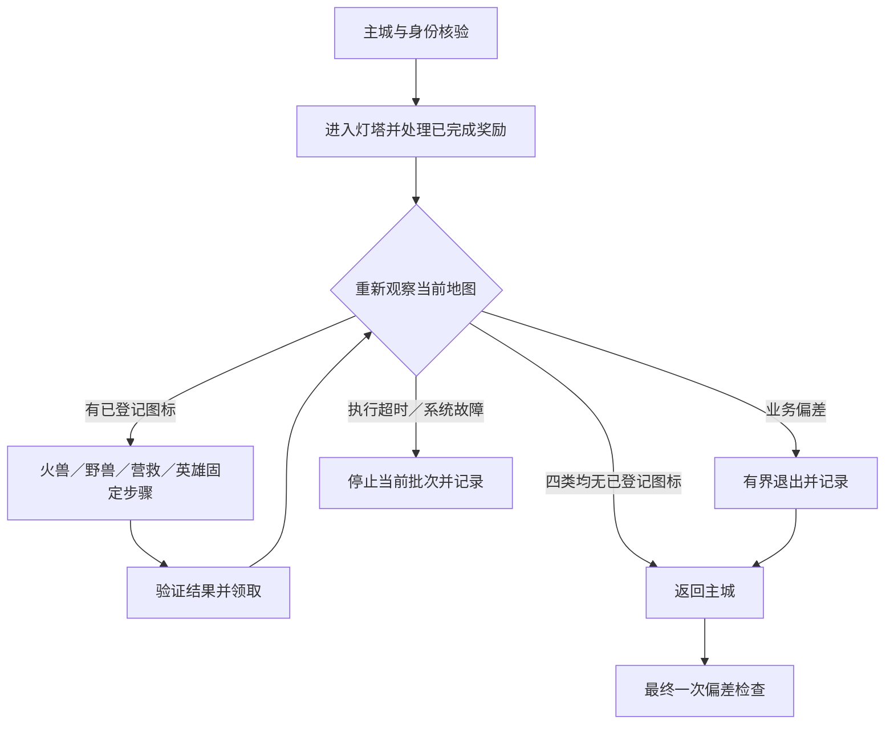

# 本地流程卡与录制历史

早期卡片保留当时验证范围，当前实现与验收以visit-plan、catalog和最新本地证据为准。

流程卡是状态机规格，不是仅按坐标回放的录像。坐标只适用于已校准788×1079窗口（含标题栏）；换尺寸、语言或UI后先重新校准。记录私有身份和证据时使用本地目录。

## 探索挂机收益：真实领取与冷却回放均通过

状态链：主城 → 领主档案核验身份 → 主城 → 探索 → 挂机收益 → 奖励层 → 探索灰色领取 → 主城。

- 主城锚点：英雄、背包、野外。头像进入领主档案，ID与王国同时核验。
- 探索入口在左下；探索页同时出现“探险”和“领取”。进入挂机面板后须见“挂机收益”“挂机时间”。
- 读取单个时长，先核验当前可领与累计时长范围，再点领取。出现奖励层才能记录真实领奖。
- 返回探索页后核验领取按钮灰态。已在冷却时明确跳过打开/领取/关闭奖励三步，不靠重复点击试探。
- 领取间隔和挂机累计上限分别记，不用领取冷却阻塞其他日常。

## 邮件：报告、系统、联盟批量处理

状态链：主城 → 邮件 → 报告 → 一键已读&领取 →（有奖励才关闭奖励）→ 系统同理 → 联盟同理 → 主城。

- 标题与分类栏组合识别邮件页，选中的系统可能被OCR识别为“系統”，不要只靠该单一字形确认页面。
- 领取按钮在底部右侧；本地OCR可在限定底部区域内寻找“一键已读”唯一匹配，不用模型认按钮。
- “删除所有已读”在另一侧，永不调用。
- 新奖励层与无新奖励是不同分支；按钮可点不代表有新收益。
- 人工报告领取已出现奖励层；宏回放验证了无新奖励分支。其他分类的新奖励分支仍需按实际运行继续积累证据。

## VIP：免费礼包冷却检查

状态链：主城VIP → 免费礼包区域 → 主城。

免费礼包区域约为窗口y638–745；倒计时读取区域为[500,675,645,735]。页面下方另有VIP有效期倒计时，不能混用。当前宏只做冷却检查；未来免费按钮出现时应进入另行验证的领取分支，不能把检查成功写成领取成功。现金礼包独立，不点。

## 丰盛的招待：人工领奖与宏冷却回放通过

状态链：主城头像 → 领主档案 → 体力旁+ → 丰盛的招待 → 免费领取 → 档案 → 主城。

本轮观察免费领取后体力增加160，超过常规200上限仍可领。退出后记录体力和下次补给倒计时。体力罐“使用”、钻石“购买并使用”不属于免费餐，不能因缺体力替代点击。

校准线索：头像[137,65]、体力+[289,944]、免费餐按钮[573,341]；实际点击仍须标题、按钮可用状态和视觉条件通过。宏已验证已领/冷却分支，下一次可领时仍需验证真实领取分支。

## 曙光学院补给：人工领奖与宏冷却回放通过

状态链：主城概览 → 日常游历补给 → 学院页面上方背包 → 免费补给 → 关闭。

本轮领取后补给增加10。返回时可能仍留在学院建筑位置，不把建筑位置变化当页面变化失败。概览列表会滚动、内容随等级变化，不能把当时列表行坐标直接设成永久入口。宏已使用“游历补给”行的局部OCR与校准偏移进入，未匹配时停止；免费按钮下方钻石购买分开。真实可领分支仍待下一次现场验证。

## 联盟礼物与互助：人工领奖、宏空箱回放通过

主城联盟→互助检查→返回→联盟宝箱→战利品页批量领取→有奖励才关闭→盟友赠礼页同理→联盟→主城。底部批量按钮需同时满足标题与绿色区域条件；灰色或空箱明确跳过，不能把跳过写成新领奖。手工操作出现了真实奖励层，宏回放验证了两分类的空奖励分支。互助目前仅检查，不自动处理新出现的帮助请求；后续可按当前开发授权采样补全。

## 训练：数量输入必须读回

队列完成时先领兵，再按本号兵种/等级目标续队。焦点、全选、输入、确认应分别有状态核验。实操中一次过快批量按键曾保留旧数量，必须在最终训练前读回。高阶新训与低阶晋升分别统计，未查看低阶兵不能记为“全兵种已核验”。

## 录制验收

每个流程分别记录：真实可领奖励、已经领取/冷却、页面不符、OCR失败四类证据。只有在校准尺寸和当前版本完成回放的分支才放入已验证宏目录。未覆盖分支可由agent开发采样并提炼宏，另记人工处理证据；不因其他分支通过而宣布整个玩法自动化完成。

## 早期人工开发的实操资料（不是当前执行清单）

- **治疗入口**：民用“医务室”与军队“军医所”不同。以军医所标题、伤兵数量和治疗计时确认，不凭绿十字图标推断。生产/民用建筑有延迟加载的室内家具界面，过早重复点击可能切回室外；先观察加载结果再继续。
- **建造目标**：优先明确主线或角色目标。已授权的普通资源可正常使用，不因谨慎一直空队列；钻石、火晶和付费加速另遵账号策略。不为日常积分取消已有长期研究。
- **狩猎预设**：前一队仍在返回时，预设可能加载出空英雄。等待实际返回提示后重选，并核验英雄头像、当前胜率提示及体力成本再出征。曾实测Gina预设将10体力降为8；不能把此数字套到所有技能等级。
- **采集完成证据**：麝牛技能要衔接实际抵达无人资源点，负重覆盖该矿总量，并读回采集报告；“已派出”“已抵达”“已采完”分别记录。普通采集的最后到达状态未复查时如实保留，不能用同轮另一队成功代替。
- **招募冷却**：免费高级招募可能在多次免费机会之间出现约5分钟冷却。先做其他任务再顺路补，不站等、不用钥匙或钻石假装完成免费次数。史诗招募的当前倒计时单独记录。
- **情报分类**：普通情报清空后仍可能有火焰头骨等悬赏活动入口。普通任务与活动剩余分别说明，不把地图还有图标等同于本轮普通情报未完成。

## 任务组合边界

每项宏成功路径已有主城起止，但失败路径尚未保证退出。固定锚点、预定义退出与任务级失败隔离的目标规格见 [任务设计](../../../docs/WOS-V2-TASK-DESIGN.md)。当前遇错仍会停止批处理，不将设计目标写成已实现。

## 烈焰与獠牙：录制卡

周期按用户提示先归双周活动，实际是否开放、剩余采集/兑换时间读取本服务器活动实例，不以固定14天代替现场。wiki描述通常前两天获得晶核、第三天兑换；日历差异须现场记录。[活动资料](https://www.whiteoutsurvival.wiki/events/flame-and-fang/)

固定主城入口→野外→情报；普通营救/英雄/野兽保留各自动作，活动新增“狩猎炽红巨兽”独立动作。准确标题而非地图火焰背景决定业务分支。点击已完成图标会直接领奖，不能用它做只读详情检查；一键领取也可能同时收普通和活动收益。

已采样：未完成火兽→前往查看→带推荐实力及攻击的NPC菜单→普通出征路径。实际10体力与推荐实力只作当前样本，奖励10晶核已在开发操作观察，不算宏通过。活动商店与现金礼包分开；兑换策略需保留具体品类/次数证据，不因有晶核就自动清空商店。

情报页左侧艾格妮丝头像是领取追加情报入口，当前样本实际增加8条；不是活动帮助按钮。追加情报会改变待办分母，必须单独记录，不把旧的最多6条假定为今日全部任务。

### 固定本地灯塔循环

这是生成的固定步骤清单，不在运行时让模型选动作。跳过分支的依赖步骤不截图；下一次真正可执行的步骤仍重新观察。无已登记图标只表示本地结束条件，最终检查若见未知或漏识别图标，仍记偏差。个别组件的实际领取不等于整个刷新周期清空。

## 巨兽集结：下一轮必须补录

周期为日，每日前10次奖励机会，不依赖红点，也不是额外角色目标。把发起集结、队伍出发、战斗成功和奖励结算分别记录；开启自动加入或看到集结计时均不算完成。优先从游戏奖励说明/剩余次数核验当日额度，手动已完成的次数计入，不能每班重复硬发十次。若界面没有可靠计数，结合当日邮件/本地成功记录明确证据缺口，不把随机没有掉落误判为没有出征。

录制路径：固定主城入口→野外NPC搜索→巨兽详情及推荐实力→集结配置→实际发起→回主城；等待与结果核验可独立为后续步骤，保留队伍/体力/其他任务依赖，不占着宏盲等十次。目标只限游戏NPC；实际界面、首次完整出征和退出锚点尚待采样，所以当前状态为没做。

## 地心探险：必须验收扫荡正分支

日/周开放窗口分别记录。进入区域、点击扫荡、确认奖励、关闭奖励和回主城须有同一次现场证据；无可用区域跳过只能证明空分支。先核对可扫荡标记和按钮，已扫区域/未开放区域不启动挑战，不以尝试次数消耗代替领奖成功。周期进度奖励须另列，不能用区域扫荡通过推断全部宝箱已领。
